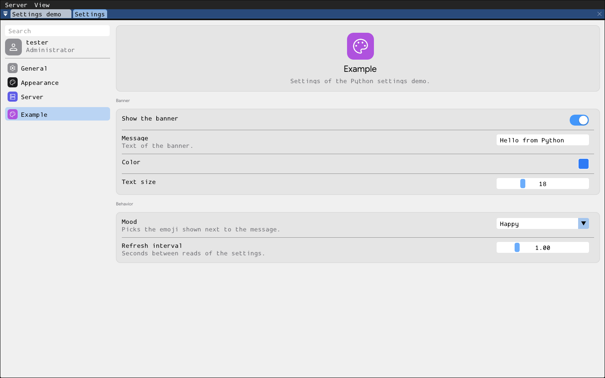

# conf



**Settings**: an editor for the settings of your apps and of the server,
modeled on macOS System Settings. Its whole UI is built from the settings
metadata apps record in the stores; see [docs/settings.md](../../../../docs/settings.md).

```sh
wish client --run conf --username alice     # Start > Settings on wish desktop
```

- **Sidebar:**
  - a search box;
  - the signed-in identity, "Administrator" or "User settings";
  - the categories, each with a colored icon badge: General, Appearance,
    Desktop and Server first, then the ones apps declare. A category shows
    only when it has settings.
- **Panel:**
  - the selected category's header;
  - its settings, one card per section;
  - an editor per type:

    | Type | Editor |
    |------|--------|
    | bool | switch |
    | enum | drop-down |
    | int / float | slider (with min and max) or number box |
    | string / path | text box |
    | color | color button |

    A ↺ button resets a value that differs from its default. Changes are
    validated and saved at once; an invalid value shows its error under
    the row.
- **Search:** lists every matching setting across categories.
- **Server settings** (e.g. the saved default theme of `wish server`) are
  editable only by settings admins (`wish server --settings_admins=alice`;
  always in `wish standalone`). Everyone else sees them read-only.
- **Live:** the tool re-reads the stores every two seconds, so settings that
  other apps declare or change appear while it is open.

Anonymous sessions (`--anonymous`) have no user store; the panel explains
how to connect with one. Without `--username`, the tool connects as the OS
user.

- **server/**: `Conf` form (`register_conf()`), a `common::tool_form` that
  reads both stores through `src/context/settings_store.hpp`, builds the
  sidebar and panel from JSON layouts, and writes values back. RMI methods
  `refresh` and `select {id}`.
- **client/**: `run_conf(wish_app_host&)`, self-registered as the `"conf"`
  embedded app. It instantiates the form, calls `refresh` every two seconds
  and keeps it alive until the window closes.
- **resources/embedded/i18n/**: English, Spanish and French strings.

Tested in `tests/test_conf.cpp`.
