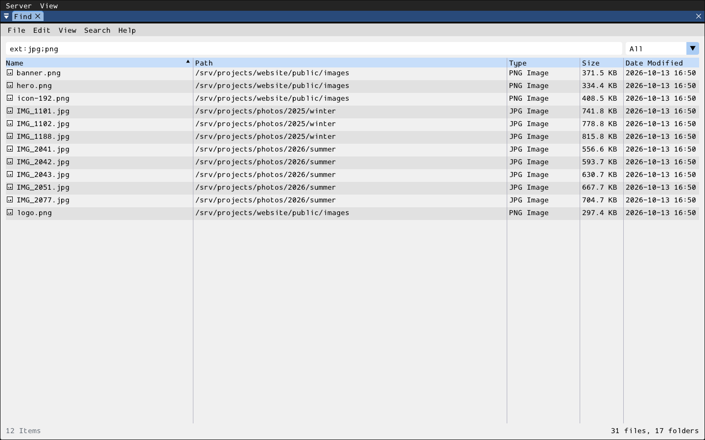

# find



Instant file search in the spirit of [FSearch](https://github.com/cboxdoerfer/fsearch):
local folders are indexed once into an in-memory database, and every
keystroke searches that database -- no disk access while you type. Laid out
like FSearch:

- **Menu bar** -- File (Open, Open Folder, Update Database, Close), Edit
  (Copy Name / Path / Full Path of the selection, Deselect All), View
  (Status Bar, Filter), Search (Match Case, Search in Path, Regular
  Expression), Help (Search Syntax, About).
- **Search field** with the **filter** drop-down on its right: All,
  Folders, Files, Applications, Archives, Audio, Documents, Pictures,
  Videos.
- **Results** -- Name, Path, Type, Size, Date Modified. Click a header to
  sort, drag to resize or reorder, right-click a header to hide a column.
  Click, Ctrl+click and Shift+click select; double-click opens with the
  system's default application; right-click a row for Open, Open Folder
  and the copy actions.
- **Status bar** -- the match count (and selection), the active search
  modes and filter, and the size of the database.

```sh
wish client --run=find                     # the "Indexed folders" setting, else ~
wish client --run=find -- /srv /var/log    # given folders
```

Query syntax (Help > Search Syntax): space-separated terms must all match;
`OR` / `|` between two terms (binds tighter than AND), `!term` / `NOT term`,
`"quoted text"`. A term matches anywhere in the name; `*`/`?` make it a
wildcard over the whole name; a term containing `/` searches the full path.
Case is ignored unless Match Case is on or the query has an upper-case
letter. Functions: `ext:jpg;png`, `file:`, `folder:src`, `size:>10mb`,
`size:1k..2m`, `dm:today` / `yesterday` / `thisweek` / `thismonth` /
`thisyear` / `2026-01-31` / `>2026-01-01` / `2026-01..2026-03`, and the
`path:` `case:` `nocase:` `exact:` `regex:` term modifiers. With Regular
Expression on, the whole query is one ECMAScript regular expression.

At most 1,000 results are listed (the status bar gives the full count);
refine the query or sort to bring others to the top. Settings (`wish client
--run conf`, category "find"): indexed folders, excluded names or paths,
exclude hidden files, stay on one filesystem, automatic match case / path
search, and the remembered Search and View toggles.

- **server/**: `Find` form (`register_find()`), a `common::tool_form`
  owning the window, the search state (query, filter, modes, sort), the
  selection and the menus. It has no filesystem access -- the files live on
  the client's machine -- so it emits `on_search` (answered with
  `show_results()`, stale generations dropped), `on_update_database`,
  `on_open` / `on_open_folder`, and `closed`.
- **client/**: `run_find(wish_app_host&)`, self-registered as the `"find"`
  embedded app. `find_db.hpp/.cpp` is the index and query engine (plain
  C++, no bison dependency; entries presorted by name and folders ranked by
  path, so a query only filters and partially sorts what it shows).
  `find.cpp` indexes on one `common::command_worker`, searches on another
  (skipping superseded keystrokes) and opens files on a third
  (`xdg-open` / `open` / `start`).
- **resources/**: `i18n/` (en, es, fr).
