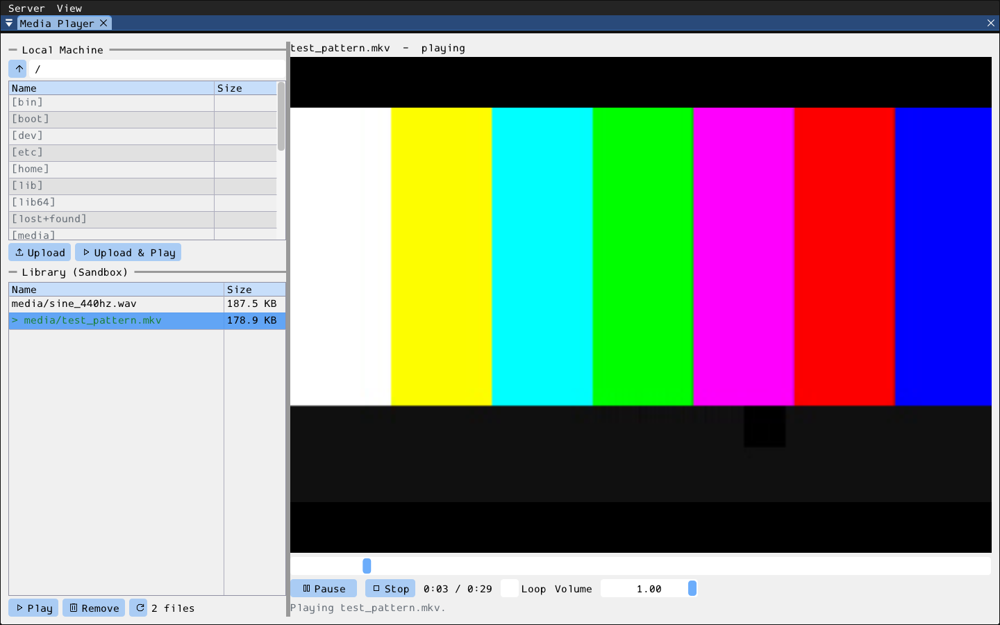

# mpv

Media player built on wish's server-side playback ([docs/media.md](../../../../docs/media.md)).
The left column lists the **Local Machine** (the client's own folders and
media files, like mc's local panel) above the **Library**: every media file
in the session sandbox. The right side is the player: a `Video` widget (a
black box for audio-only files), a seek bar, Play/Pause and Stop, the time,
**Loop** and **Volume**.

- Double-click a local media file to upload it to the sandbox's `media/`
  folder and play it. **Upload** copies the selected files there without
  playing them (Ctrl+click or Shift+click to select several), and **Upload &
  Play** also plays the first one. Larger transfers show the shared progress
  dialog, with a Cancel button.
- Double-click a Library file (or select it and press **Play**) to play it.
  **Remove** deletes the selected file from the sandbox, after you confirm.
  The Library is the whole sandbox minus its built-in `res/` and tools'
  `private/` folders, so files uploaded with mc or any other tool show up
  too after a refresh (`F5`).
- Click the picture to toggle play/pause. Drag the seek bar to jump.
- Start with a folder: `wish client --run=mpv -- ~/Videos`.

The server decodes and plays the file (FFmpeg, miniaudio). The tool links
no media library on the client. On a server built without media support, a
note says so: files can still be uploaded, but not played. A server without
a sound card plays silently, in real time, and shows "(no sound card on the
server)". With the web renderer, keep videos small: every frame goes to the
browser as raw RGBA.

- **server/**: `Mpv` form (`register_mpv()`), a `common::tool_form` owning
  the window, the local list (filled by the client through
  `update_local_listing()`, filtered to folders and media files), the
  sandbox library (scanned directly, `scan_library()`) and Remove. It never
  decodes anything. It emits `on_local_navigate`, `on_upload_requested`
  (`{names, local_path, dest, play, player, loop, volume}`),
  `on_open_requested` (`{path, player, loop, volume}`), `on_control`
  (`{action: play|pause|stop|seek|volume|loop|close, value}`) and `closed`.
  The client reports back through `update_status()`, `media_unavailable()`,
  `refresh_library()` and the `status`/`status_error` fields. The form names
  the media player (`player` field, also its `Video.player`) after its own
  root, so two mpv windows in one session don't collide.
- **client/**: `run_mpv(wish_app_host&)`, self-registered as the `"mpv"`
  embedded app with an optional `folder` argument. It lists local folders
  and uploads files as jobs on one `common::command_worker`, and opens and
  drives the player through the client media API
  (`wish_app_host::open_media()`, `media_player`) on a second worker, so a
  long upload never delays a Pause. A background thread polls the player's
  `status()` four times a second for the seek bar and labels.
- **resources/**: translations (`i18n/en.lang`, `es.lang`, `fr.lang`).

## Keyboard

Every control can be reached with Tab / Shift+Tab and pressed with Space or Enter; hold Alt to see the underlined access keys (Alt+letter).

- `F5` refreshes the Library.
