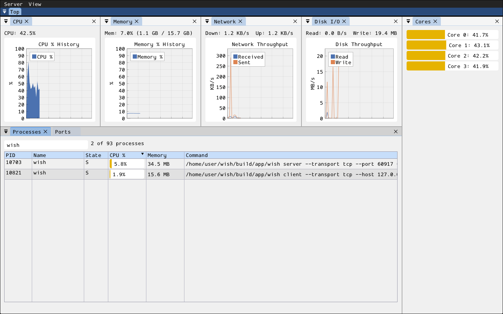

# top

top/htop-style system monitor laid out as seven dockable panels inside its
own nested "Top" dockspace (see [docs/dock-layout.md](../../../../docs/dock-layout.md)):
**Processes** (sortable table with a name filter, right-click a row for kill/pause/priority/
affinity/properties), **CPU** and **Memory** (history graphs), **Network**
(received/sent throughput graph plus totals, loopback excluded), **Disk I/O**
(read/written throughput graph plus totals, physical disks only), **Ports**
(listening TCP/UDP sockets with their owning process; another user's
sockets show `-` unless top runs elevated), and **Cores** (one meter per
logical core). The throughput graphs rescale to their visible peak and pick
a B/s..GB/s unit. The first run seeds a row of graphs above the process
table (with Ports as a second tab next to it) and the core meters along
the right; rearrange freely afterwards (Shift+drag to re-dock). The title-bar X
closes the tool.
All sampling is client-side
(inherently OS-specific, and the machine a user wants visibility into is
their own) — the server-side form only renders whatever snapshot it was
last given.

- **server/**: `Top` form (`register_top()`) —
  read-only rendering of whatever snapshot its `update_snapshot` RMI method
  was last called with.
- **client/**: `run_top(wish_app_host&)`, self-registered as
  the `"top"` embedded app — owns process/CPU/memory/network/disk/port
  sampling (platform-specific: `process_info_linux.cpp` reads `/proc` and
  `/sys/block`; `process_info_win.cpp` uses `GetIfTable2`,
  `IOCTL_DISK_PERFORMANCE` and `GetExtendedTcpTable`/`UdpTable`) and
  periodically pushes a fresh snapshot to the form.
- **resources/**: none.

## Keyboard

Every control can be reached with Tab / Shift+Tab and pressed with Space or Enter; hold Alt to see the underlined access keys (Alt+letter).

- Affinity dialog: `Enter` applies, `Esc` cancels.

## Settings

In Settings (`bdg/desktop/conf`), under the tool's own category:

- **Refresh interval** -- milliseconds between samples (default 1000).
- **Graph history** -- samples in the CPU and memory graphs (default 60).
